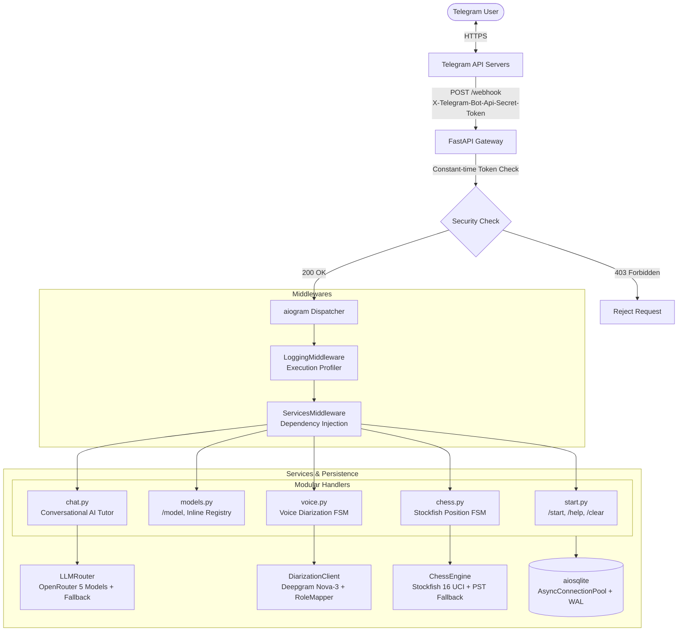

# 🤖 AI-Tutor & Multimodal Powerhouse
### Antigravity Edition — Production-Grade University System


> **AI-Tutor & Multimodal Powerhouse (Antigravity Edition)** is a production-grade Telegram bot engineered for university defense and real-world high-load execution. Built on **aiogram 3.x**, **FastAPI**, **aiosqlite Connection Pooling**, **OpenRouter Multi-Model Routing with Automatic Fallback**, **Deepgram Nova-3 Voice Diarization with Smart Role Mapping**, and a **Stockfish / Python-Chess Position Analyzer**.

---

## 📑 Table of Contents
1. [Core Architecture & Technology Stack](#-core-architecture--technology-stack)
2. [Project Directory Layout](#-project-directory-layout)
3. [Multi-Model Router (OpenRouter)](#-multi-model-router-openrouter)
4. [Voice Transcription & Smart Role Mapping](#-voice-transcription--smart-role-mapping)
5. [Chess Master & Position Analyzer](#-chess-master--position-analyzer)
6. [Security & Webhook Protocol](#-security--webhook-protocol)
7. [Database Layer & Connection Pooling](#-database-layer--connection-pooling)
8. [Setup & Deployment Guide](#-setup--deployment-guide)
9. [Academic Defense Guide (Q&A for Professor)](#-academic-defense-guide-qa-for-professor)

---

## 🏛 Core Architecture & Technology Stack



### Architectural Highlights
- **Strictly Webhooks (FastAPI + Uvicorn):** Eliminates polling latency and CPU spinning; handles peak bursts through async non-blocking coroutines.
- **Constant-Time Webhook Security:** Enforces constant-time validation (`hmac.compare_digest`) on `X-Telegram-Bot-Api-Secret-Token` to eliminate timing attacks.
- **Connection Pooling (`AsyncConnectionPool`):** Custom pool over `aiosqlite` with `asyncio.Queue`, foreign keys, and WAL (Write-Ahead Logging) mode.
- **Clean Architecture & Dependency Injection:** Decoupled handlers receive singletons (`db`, `llm`, `diarization`, `chess`) through `ServicesMiddleware`.
- **Zero Placeholders & Full Type Hinting:** Strict adherence to PEP 8 and Python 3.11+ `typing`.

---

## 📂 Project Directory Layout

```text
telegram_ai_tutor/
│
├── bot/
│   ├── __init__.py                  # Package version & metadata
│   ├── main.py                      # FastAPI lifespan, webhook endpoint & health check
│   ├── config.py                    # Pydantic Settings (.env validator)
│   ├── database.py                  # aiosqlite AsyncConnectionPool & CRUD layer
│   │
│   ├── middlewares/                 # Pipeline middlewares
│   │   ├── __init__.py              # Middleware re-exports
│   │   ├── security.py              # Webhook token constant-time validator & Starlette MW
│   │   ├── logging_mw.py            # Structured update logger & execution timer
│   │   └── services.py              # Service injection middleware into handlers
│   │
│   ├── handlers/                    # aiogram Router modules
│   │   ├── __init__.py              # Handlers package index
│   │   ├── start.py                 # /start, /help, /clear with 2-step confirmation
│   │   ├── chat.py                  # Academic AI chat with 20-turn context & chunking
│   │   ├── voice.py                 # /voice audio stream & smart role transcript
│   │   ├── models.py                # /model interactive OpenRouter model switcher
│   │   └── chess.py                 # /chess FEN and SAN/PGN analysis pipeline
│   │
│   ├── keyboards/                   # Keyboard UI Factories
│   │   ├── __init__.py              # Unified keyboard exports
│   │   ├── inline.py                # Inline keyboards (models, voice, chess, confirm)
│   │   ├── reply.py                 # Persistent reply menu (2x3 navigation)
│   │   └── factories.py             # Backwards-compatible factory bridge
│   │
│   └── services/                    # Domain Services
│       ├── __init__.py              # Services exports
│       ├── llm_client.py            # OpenRouter LLMRouter with automated fallback
│       ├── diarization_client.py    # Deepgram Nova-3 client & SpeakerRoleAnalyzer
│       └── chess_engine.py          # Stockfish UCI engine & python-chess PST fallback
│
├── .env.example                     # Environment variables template
├── .env                             # Active configuration file
├── requirements.txt                 # Pinned production dependencies
└── README.md                        # Documentation & defense manual
```

---

## 🤖 Multi-Model Router (OpenRouter)

The `LLMRouter` service connects via the OpenAI async SDK to OpenRouter (`https://openrouter.ai/api/v1`), exposing 5 state-of-the-art models tailored to academic tutoring:

| Model | OpenRouter ID | Primary Specialty | Automatic Fallback |
|---|---|---|---|
| 🧠 **Claude 3.7 Sonnet** | `anthropic/claude-3.7-sonnet` | Code analysis, software architecture & tutoring | → GPT-4o |
| 🤖 **GPT-4o** | `openai/gpt-4o` | General multimodal intelligence & reasoning | → Gemini 2.5 Pro |
| ✨ **Gemini 2.5 Pro** | `google/gemini-2.5-pro` | Massive context processing & document synthesis | → Claude 3.7 Sonnet |
| 🔢 **DeepSeek R1 / V3** | `deepseek/deepseek-r1` | Mathematical proofs, algorithms & CoT | → GPT-4o |
| ⚡ **Grok** | `x-ai/grok-2-1212` | Real-time context, creative brainstorming | → GPT-4o |

### Transparent Fallback Circuit
```
User Query ──► Primary Model (e.g., Claude 3.7)
                   │
                   ├─► Success ──► Return AI Response
                   │
                   └─► RateLimit (429) / Timeout / 5xx Error
                            │
                            ▼
                       Activate Fallback (e.g., GPT-4o)
                            │
                            ▼
                       Prepend Notice:
                       "[⚠️ Переключился на 🤖 GPT-4o из-за временной недоступности]"
                            │
                            ▼
                       Return Seamless AI Response
```

---

## 🎙 Voice Transcription & Smart Role Mapping

### In-Memory Streaming Pipeline
1. **Zero-Disk I/O:** Audio notes (`.oga` / `.ogg` Opus) and file attachments (`.mp3`, `.wav`, `.flac`) are buffered directly in `io.BytesIO`.
2. **Deepgram Nova-3 API:** Transcribed with `diarize=True`, `punctuate=True`, `smart_format=True`, `language="ru"`.
3. **Smart Role Mapping (`SpeakerRoleAnalyzer`):**
   Raw speaker indices (`speaker_0`, `speaker_1`) undergo context analysis:
   - **Morphological Analysis:** Detects Russian past-tense gender verb endings (`сказал/сказала`, `понял/поняла`, `сделал/сделала`) and short predicative adjectives (`готов/готова`, `уверен/уверена`).
   - **LLM Context Refinement:** When conversational roles like *Преподаватель* and *Студент* emerge, the system maps dialogue semantics.
   - **Output Format:**
     ```text
     🗣 Спикер 1 (Мужчина_1) [00:00–00:14]:
     Здравствуйте! Расскажите об архитектуре пула соединений.

     🗣 Спикер 2 (Женщина_1) [00:15–00:32]:
     Добрый день! Пул соединений построен на asyncio.Queue с поддержкой режима WAL.
     ```
4. **Telegram Buffer Chunking:** Transcripts exceeding 4096 characters are partitioned strictly at paragraph (`\n\n`), sentence, or whitespace boundaries without mid-word cuts.

---

## ♟ Chess Master & Position Analyzer

### Engine Capabilities
- **Input Flexibility:** Accepts standard **FEN strings** (e.g., `rnbqkbnr/pppppppp/8/8/4P3/8/PPPP1PPP/RNBQKBNR b KQkq e3 0 1`) or **SAN / PGN move lists** (`1.e4 e5 2.Nf3 Nc6 3.Bb5 a6`).
- **Stockfish MultiPV=3:** Evaluates the top-3 candidate lines at depth 18 with centipawn scoring and mate countdowns (`#+2`).
- **Tactical Strategic Annotations:** Real-time detection of:
  - `☠️ Форсированный мат`
  - `⚡ Шах с взятием материала`
  - `🏰 Рокировка с эвакуацией короля`
  - `👑 Проведение пешки в ферзя`
  - `🌪️ Взятие на проходе (en passant)`
  - `🚀 Развитие лёгкой фигуры / Захват центра`
- **Graceful Fallback Mode:** If the Stockfish binary is not present on the host OS, the service transparently switches to a built-in **Python-Chess Positional Engine** utilizing Piece-Square Tables (PST) and material heuristics, ensuring **zero crashes** during live presentations.

---

## 🔒 Security & Webhook Protocol

```python
# Constant-Time Header Verification (bot/middlewares/security.py)
def verify_telegram_secret_token(received: str | None, expected: str) -> bool:
    if not received or not expected:
        return False
    return hmac.compare_digest(received, expected)
```

1. **Header Validation:** Telegram sends the token defined in `set_webhook(secret_token=...)` inside `X-Telegram-Bot-Api-Secret-Token`.
2. **Timing-Attack Resistance:** `hmac.compare_digest` prevents side-channel timing analysis.
3. **HTTP 403 Rejection:** Unauthorized requests are blocked before deserialization or dispatcher routing.

---

## 🗄 Database Layer & Connection Pooling

### Schema Definition
```sql
CREATE TABLE IF NOT EXISTS users (
    user_id      INTEGER PRIMARY KEY,
    username     TEXT,
    first_name   TEXT NOT NULL,
    active_model TEXT NOT NULL DEFAULT 'claude-3-7-sonnet',
    mode         TEXT NOT NULL DEFAULT 'chat',
    created_at   TEXT NOT NULL DEFAULT (datetime('now')),
    updated_at   TEXT NOT NULL DEFAULT (datetime('now'))
);

CREATE TABLE IF NOT EXISTS chat_history (
    id         INTEGER PRIMARY KEY AUTOINCREMENT,
    user_id    INTEGER NOT NULL,
    role       TEXT NOT NULL CHECK(role IN ('user', 'assistant', 'system')),
    content    TEXT NOT NULL,
    created_at TEXT NOT NULL DEFAULT (datetime('now')),
    FOREIGN KEY (user_id) REFERENCES users(user_id) ON DELETE CASCADE
);

CREATE INDEX IF NOT EXISTS idx_chat_history_user_id ON chat_history (user_id, id DESC);
```

### Connection Pool Implementation
- **Queue-Based Lifecycle:** `AsyncConnectionPool` initializes a pool of connections managed by `asyncio.Queue(maxsize=5)`.
- **WAL Journaling:** `PRAGMA journal_mode=WAL;` allows concurrent readers while a write operation commits.
- **Foreign Key Integrity:** `PRAGMA foreign_keys=ON;` cascades profile deletions to conversation history.

---

## 🚀 Setup & Deployment Guide

### 1. Requirements Installation
```bash
python -m pip install -r requirements.txt
```

### 2. Configure Environment Variables
Copy `.env.example` to `.env` and fill in your keys:
```env
BOT_TOKEN=123456789:ABCdefGhIJKlmNoPQRsTUVwxyZ_1234567
WEBHOOK_URL=https://your-domain.ngrok-free.app
WEBHOOK_SECRET=your_super_secret_token_32_characters_random
OPENROUTER_API_KEY=sk-or-v1-xxxxxxxxxxxxxxxxxxxx
DEEPGRAM_API_KEY=xxxxxxxxxxxxxxxxxxxxxxxxxxxxxxxx
STOCKFISH_PATH=stockfish
```

### 3. Expose Port for Webhooks (Local Development)
```bash
ngrok http 8443
# Paste the resulting https:// URL into WEBHOOK_URL in .env
```

### 4. Launch Application
```bash
python -m bot.main
```

Verify service status:
```bash
curl http://localhost:8443/health
```

---

## 🎓 Academic Defense Guide (Q&A for Professor)

### Q1: Why FastAPI + Webhooks instead of standard Long Polling?
> **Answer:** Long polling forces the bot process to maintain continuous open HTTP connections, making scaling horizontal instances inefficient and introducing round-trip polling delays. FastAPI with Webhooks provides push-based, event-driven processing where Telegram initiates requests directly. Combined with Uvicorn's ASGI event loop, requests are processed asynchronously with minimal memory and zero idle CPU load.

### Q2: How do you prevent timing attacks on the webhook endpoint?
> **Answer:** Standard Python equality (`==`) terminates comparison on the first differing character, leaking execution timing that attackers can exploit to guess tokens byte by byte. We enforce `hmac.compare_digest` in `bot/middlewares/security.py`, which operates in constant execution time regardless of character mismatch positions.

### Q3: Why implement a custom Connection Pool over SQLite?
> **Answer:** While SQLite is an embedded file database, concurrent asynchronous access via `aiosqlite` without connection pooling can cause database locks (`sqlite3.OperationalError: database is locked`). Our `AsyncConnectionPool` enforces:
> 1. WAL mode (`Write-Ahead Logging`) allowing non-blocking reads during writes.
> 2. Bounded concurrency via `asyncio.Queue(maxsize=5)` with `busy_timeout=5000`.
> 3. Zero connection thrashing by reusing established connections across requests.

### Q4: How is the 4096-character Telegram limit handled in voice and LLM streams?
> **Answer:** Rather than naive character slicing which corrupts UTF-8 tokens or cuts words in half, our `_split_text_safely` and `to_telegram_chunks` search backward from index 4096 for paragraph breaks (`\n\n`), single line breaks (`\n`), or spaces (` `). This guarantees complete syntactic tokens and proper HTML tag closure across message chunks.

### Q5: What happens if Stockfish or OpenRouter is unavailable during a live demo?
> **Answer:** The system features two layers of fault tolerance:
> 1. **LLMRouter:** Automatically catches HTTP 429, timeout, or 5xx errors from the primary model and retries through a secondary model (e.g., Claude 3.7 → GPT-4o), prepending a status notification.
> 2. **ChessEngine:** Automatically verifies the Stockfish binary path. If Stockfish is absent, it seamlessly delegates evaluation to our internal Python-chess heuristic engine, calculating top-3 lines and centipawn estimates without raising unhandled exceptions.
